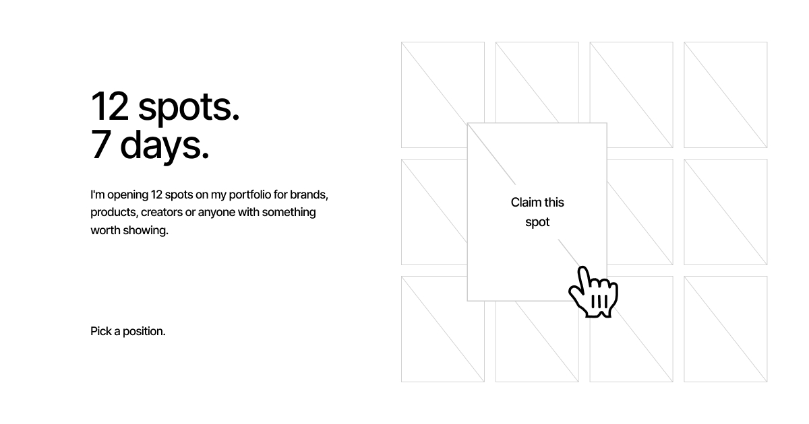

# Spots — 12 spots. 7 days.



[Live site](https://spots.eugenezaycev.com/) · [How it works](https://spots.eugenezaycev.com/how-it-works.html) · [About](https://spots.eugenezaycev.com/about.html)

Spots is a small, self-initiated product and design experiment by [Eugene Zaycev](https://www.linkedin.com/in/eugenezaycev/). It turns portfolio traffic generated by a job search into twelve temporary placements for brands, products, and creators.

Each participant chooses one of twelve positions, pays what they think it is worth, uploads a logo, and submits a link. After manual review, the logo is displayed for seven days. The approved contribution is public, outbound visits are measured, and the participant receives status emails throughout the process.

This repository contains the complete public site, application flow, admin panel, storage layer, analytics integration, and Cloudflare deployment configuration.

## The starting point

The project started with a simple observation:

> Every job application sends a new recruiter, hiring manager, designer, or marketer to the same portfolio.

Instead of treating that traffic as passive attention, the first version turned it into a visible experiment:

- tell the honest story behind the traffic;
- arrange twelve claimable cards around the page;
- let visitors choose a position;
- keep the experience deliberately small, direct, and personal.

The first commit, `Create Slots scroll site`, established the desktop scroll narrative and the twelve-card composition. Everything that followed turned that visual prototype into a working product.

## Where the project is now

The current version includes:

- a pinned, scroll-driven story on desktop;
- a compact, touch-friendly story and three-column spot board on mobile;
- twelve live spot states: available, pending review, and published;
- logo upload by file picker or drag and drop;
- Revolut Pay handoff with a spot-specific payment reference;
- manual approval, rejection, creation, logo replacement, and removal in `/admin`;
- a public approved amount and a seven-day countdown for every published spot;
- click tracking through a first-party redirect;
- D1 persistence and R2 logo storage;
- application, approval, rejection, and expiry emails through an optional mailer endpoint;
- automatic expiry checks every hour;
- live and total visitor counts from Umami;
- SEO metadata, Open Graph images, sitemap, robots rules, and Google Search Console verification;
- reduced-motion support, keyboard interaction, focus states, labels, and a skip link;
- automatic production deployment from `main` with GitHub Actions.

The `History` page currently provides the final visual state and explains the archive concept. Automatically listing expired placements there is the main unfinished product step.

## How we got here

The repository history falls naturally into five stages.

### 1. Editorial prototype — 13 September 2026

The initial static page introduced the core story, a twelve-column layout, and twelve cards. The page then became a continuous pinned narrative with masked transitions, a fixed card gallery, and aligned controls.

### 2. Measurement and live presence — 13–14 September 2026

Umami analytics was connected, followed by a public live counter. The small green status dot and inline visitor text made the otherwise static story feel active without changing its restrained visual language.

### 3. Product and backend — 14–16 September 2026

The experiment moved from a prototype to a real submission system. A Cloudflare Worker began serving both the static files and same-origin API. D1 stores applications and click records; R2 stores submitted logos. The admin review flow, seven-day publishing window, approved amount, emails, and tracked redirects were added here.

### 4. Interaction and responsive refinement — 17 September 2026

This stage focused on the details of using the product: card naming and contrast, ring movement, the animated transfer from selected spot to upload area, payment-return behavior, submission states, error handling, and mobile card presentation.

### 5. Production hardening — 17–20 September 2026

The latest stage completed metadata and social previews, moved deployment to the repository root as the single source of truth, refined Cloudflare asset exclusions, added referral parameters to sponsor links, improved mobile story order and spot navigation, and introduced the dedicated Revolut Pay button.

## Participant flow

1. Open the Spots page and choose an available position.
2. Upload a PNG, JPG, WEBP, GIF, or SVG logo up to 5 MB.
3. Add a website and contact email.
4. Open Revolut Pay. The suggested amount is €25, but the participant chooses the final amount; the transfer includes a `spotN` reference.
5. Return to the form and submit the application.
6. The selected position changes to `Under review` and the submission appears in the admin panel.
7. The owner verifies the payment and either publishes or rejects the application.
8. On approval, the logo, approved amount, and countdown become public for seven days.
9. Sponsor clicks pass through `/go/:applicationId`, are counted, and then redirect with `ref=spots`.
10. An hourly scheduled task expires finished placements and emails the final click totals.

Payment verification is intentionally manual. The site opens Revolut Pay, but it does not receive or process payment-provider webhooks.

## Visual system

The interface uses a minimal editorial system so the story, logos, and movement remain the focus.

### Typography

| Role | Typeface | Weight | Size / line height | Tracking |
| --- | --- | --- | --- | --- |
| Primary interface | Inter, Arial, sans-serif | 500 | — | — |
| Display headings | Inter | 500 | 48px / 48px or `.98` | `-0.05em` to `-0.07em` |
| Mobile headings | Inter | 500 | `clamp(35px, 10.6vw, 48px)` / `.98` | `-0.05em` |
| Card headings | Inter | 500 | 32px / `.96` | `-0.05em` |
| Body, navigation, labels | Inter | 500 | 13px / 20px | `-0.05em` |
| Form input text | Inter | 400 | 13px / 20px; 16px on mobile | inherited |

Inter is loaded from Google Fonts in `400` and `500`. Arial is the fallback. A few fake preview logos deliberately use Georgia to demonstrate how different brand marks might occupy the cards; Georgia is not part of the core interface typography.

### Colour palette

| Token / use | Value |
| --- | --- |
| Primary text and focus | `#000000` |
| Page and card background | `#FFFFFF` |
| Primary muted grey | `#CCCCCC` |
| Borders | `#BFBFBF` / `#C8C8C8` |
| Secondary countdown text | `#AAAAAA` |
| About portrait field | `#EEF6F9` |
| Live status | `#17A34A` |
| Drag state | `#F5F5F5` |
| Error | `#DD0000` on `#FFF7F7` |
| Revolut button | `#202027`, hover `#2B2C35`, border `#2F3040` |

The main palette is intentionally almost monochrome. Green is reserved for live presence, and red appears only when action is required.

### Grid and spacing

- Desktop uses a twelve-column grid with a `24px` gutter.
- Horizontal page margins are fluid: `clamp(24px, 8.889vw, 128px)`.
- Vertical page margins are fluid: `clamp(48px, 6.667vw, 96px)`.
- Mobile switches at `800px` to `24px` horizontal and `32px` vertical margins with a `12px` grid gutter.
- Repeated spacing values are `8`, `12`, `16`, `20`, `24`, `28`, `32`, `44`, `48`, `64`, `92`, `104`, and `112px`.
- Spot cards use a `144 × 184px` base size and a one-pixel border.
- The upload area has a `456 / 582` desktop ratio and becomes square on mobile.
- The mobile spot board uses three equal columns with `12px` horizontal and `24px` vertical gaps.

The composition relies on generous negative space, precise grid alignment, square corners, thin rules, and tightly tracked type. Motion uses an ease-out curve close to `cubic-bezier(.16, 1, .3, 1)`; the spot-to-upload transition uses `cubic-bezier(.22, .8, .2, 1)` over `900ms`.

## Architecture

```text
Browser
  ├── static HTML, CSS and JavaScript
  ├── Umami public analytics API
  └── same-origin Cloudflare Worker
        ├── D1: applications and click records
        ├── R2: uploaded logo files
        ├── optional private mailer endpoint
        └── scheduled hourly expiry task
```

There is no frontend framework or build step. The browser receives the source files directly, and the Worker serves both those files and the API from the same origin.

## Project structure

```text
.
├── index.html                 Main story, spot gallery, and application form
├── styles.css                Shared layout, design system, motion, responsive UI
├── script.js                 Story, gallery, analytics, upload, payment, and API flow
├── how-it-works.html         Four-step participant explanation
├── history.html              Prepared permanent archive page
├── about.html / about.js     Profile page and portrait interaction
├── thank-you.html            Post-submission state
├── thank-you.css / .js       Thank-you layout and card animation
├── robots.txt / sitemap.xml  Search-engine discovery
├── .assetsignore             Files excluded from Worker static assets
├── .github/workflows/
│   └── deploy.yml            Production deployment after pushes to main
└── slots-backend/
    ├── src/worker.js         API, admin UI, redirects, email, and scheduled expiry
    ├── schema.sql            Complete D1 schema for a new environment
    ├── migrations/           Incremental changes for an existing database
    └── wrangler.jsonc        Worker, assets, D1, R2, variables, and cron bindings
```

## Run the interface locally

Requirements:

- any current browser;
- Python 3 for the simplest static preview;
- Node.js 22+ only when running or deploying the Worker.

From the repository root:

```sh
python3 -m http.server 8000
```

Then open [http://localhost:8000](http://localhost:8000).

This previews all static pages and interactions. Calls to `/api/spots` will fail gracefully because the static server does not include the Worker, so no real pending or published spots will be shown.

## Run the complete app locally

Wrangler can run the Worker, static assets, D1, and R2 bindings together.

```sh
cd slots-backend
npx wrangler d1 execute slots --local --file=schema.sql
npx wrangler dev --config wrangler.jsonc
```

For admin login during local development, create `slots-backend/.dev.vars`:

```dotenv
ADMIN_PASSWORD=choose-a-local-password
```

The mailer variables are optional locally. Without them, applications and review actions still work; only email delivery is skipped.

## Cloudflare setup

The production environment expects:

- a Worker named `slots-api`;
- a D1 database named `slots`, bound as `DB`;
- an R2 bucket named `slots-logos`, bound as `LOGOS`;
- `PUBLIC_ORIGIN` set to the production origin;
- `OWNER_EMAIL` set to the review-notification address;
- an hourly cron trigger;
- `ADMIN_PASSWORD` as a Worker secret;
- optional `MAILER_URL` and `MAILER_TOKEN` secrets.

Create a fresh database and add secrets from `slots-backend/`:

```sh
npx wrangler d1 execute slots --remote --file=schema.sql
npx wrangler secret put ADMIN_PASSWORD
npx wrangler secret put MAILER_URL
npx wrangler secret put MAILER_TOKEN
```

For an existing database, apply each file in `slots-backend/migrations/` once, in filename order.

Review `slots-backend/wrangler.jsonc` before deploying a fork: its database ID, account-specific resources, production origin, and owner email belong to the original deployment.

## Deployment

Every push to `main` runs `.github/workflows/deploy.yml`. The workflow checks out the repository, uses Node.js 22, and deploys the Worker plus static assets with Wrangler.

Add this GitHub Actions repository secret before the first deployment:

- `CLOUDFLARE_API_TOKEN` — a token with permission to edit Workers and access the configured D1 and R2 resources.

The workflow currently contains the original Cloudflare account ID. Replace it or move it to a `CLOUDFLARE_ACCOUNT_ID` repository secret when deploying under another account.

A manual deployment can be run from the repository root:

```sh
cd slots-backend
npx wrangler deploy --config wrangler.jsonc
```

## Main endpoints

| Method | Path | Purpose |
| --- | --- | --- |
| `GET` | `/health` | Worker health check |
| `GET` | `/api/spots` | Public pending and active placements |
| `POST` | `/api/applications` | Submit participant details and a logo |
| `GET` | `/go/:applicationId` | Count a sponsor click and redirect |
| `GET` | `/logos/:key` | Serve an uploaded logo from R2 |
| `GET` | `/admin` | Password-protected review panel |
| `POST` | `/api/admin/login` | Start a signed 12-hour admin session |
| `GET` | `/api/admin/applications` | List all applications for review |
| `POST` | `/api/admin/applications` | Create and publish a spot manually |
| `POST` | `/api/admin/applications/:id/publish` | Approve an application and start its seven days |
| `POST` | `/api/admin/applications/:id/reject` | Reject an application with an optional reason |
| `POST` | `/api/admin/applications/:id/logo` | Replace an uploaded logo |
| `DELETE` | `/api/admin/applications/:id` | Remove an application, clicks, and logo |

Unique clicks are counted as unique visitor-days: one hash of IP address and user agent per application per calendar day. Raw IP addresses and user-agent strings are not stored in the click table.

## Current boundaries

- Payments are verified manually; there is no Revolut webhook.
- The `History` page is not yet populated from expired D1 records.
- Email delivery depends on a separate private, token-protected mailer endpoint.
- There is no automated test suite yet; changes should be checked on desktop, mobile, keyboard navigation, and reduced-motion mode.
- The deployment configuration is tied to the original Cloudflare resources and must be changed for a fork.

## License

No open-source license has been added. The code and visual design remain all rights reserved unless the repository owner states otherwise.
